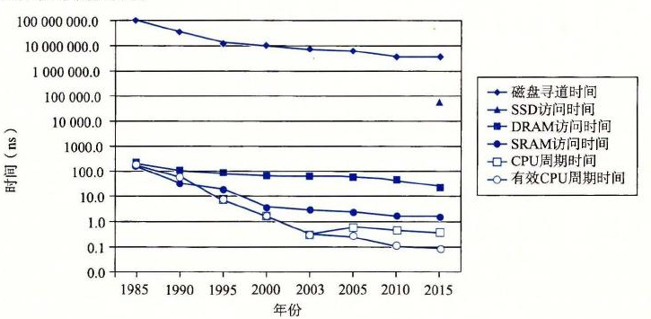

# 6.1.4 存储技术趋势

从我们对存储技术的讨论中，可以总结出几个很重要的思想：

不同的存储技术有不同的价格和性能折中。SRAM 比 DRAM 快一点，而 DRAM 比磁盘要快很多。另一方面，快速存储总是比慢速存储要贵的。SRAM 每字节的造价比 DRAM 高，DRAM 的造价又比磁盘高得多。SSD 位于 DRAM 和旋转磁盘之间。

不同存储技术的价格和性能属性以截然不同的速率变化着。图 6-15 总结了从 1985 年以来的存储技术的价格和性能属性，那时第一台 PC 刚刚发明不久。这些数字是从以前的商业杂志中和 Web 上挑选出来的。虽然它们是从非正式的调查中得到的，但是这些数字还是能揭示出一些有趣的趋势。

自从 1985 年以来，SRAM 技术的成本和性能基本上是以相同的速度改善的。访问时间和每兆字节成本下降了大约 100 倍（图 6-15a）。不过，DRAM 和磁盘的变化趋势更大，而且更不一致。DRAM 每兆字节成本下降了 44 000 倍（超过了四个数量级！），而 DRAM 的访问时间只下降了大约 10 倍（图 6-15b）。磁盘技术有和 DRAM 相同的趋势，甚至变化更大。从 1985 年以来，磁盘存储的每兆字节成本暴跌了 3 000 000 倍（超过了六个数量级！），但是访问时间提高得很慢，只有 25 倍左右（图 6-15c）。这些惊人的长期趋势突出了内存和磁盘技术的一个基本事实：增加密度（从而降低成本）比降低访问时间容易得多。

DRAM 和磁盘的性能滞后于 CPU 的性能。正如我们在图 6-15d 中看到的那样，从 1985 年到 2010 年，CPU 周期时间提高了 500 倍。如果我们看有效周期时间（effective cycle time）——我们定义为一个单独的 CPU（处理器）的周期时间除以它的处理器核数——那么从 1985 年到 2010 年的提高还要大一些，为 2000 倍。CPU 性能曲线在 2003 年附近的突然变化反映的是多核处理器的出现（参见 6.2 节的旁注），在这个分割点之后，单个核的周期时间实际上增加了一点点，然后又开始下降，不过比以前的速度要慢一些。

<table data-search="false">
<thead>
<tr>
<th>度量标准</th>
<th style="text-align:right">1985</th>
<th style="text-align:right">1990</th>
<th style="text-align:right">1995</th>
<th style="text-align:right">2000</th>
<th style="text-align:right">2005</th>
<th style="text-align:right">2010</th>
<th style="text-align:right">2015</th>
<th style="text-align:right">2015:1985</th>
</tr>
</thead>
<tbody>
<tr>
<td>美元/MB</td>
<td style="text-align:right">2900</td>
<td style="text-align:right">320</td>
<td style="text-align:right">256</td>
<td style="text-align:right">100</td>
<td style="text-align:right">75</td>
<td style="text-align:right">60</td>
<td style="text-align:right">25</td>
<td style="text-align:right">116</td>
</tr>
<tr>
<td>访问时间（ns）</td>
<td style="text-align:right">150</td>
<td style="text-align:right">35</td>
<td style="text-align:right">15</td>
<td style="text-align:right">3</td>
<td style="text-align:right">2</td>
<td style="text-align:right">1.5</td>
<td style="text-align:right">1.3</td>
<td style="text-align:right">115</td>
</tr>
</tbody>
</table>

**a）SRAM 趋势**

<table data-search="false">
<thead>
<tr>
<th>度量标准</th>
<th style="text-align:right">1985</th>
<th style="text-align:right">1990</th>
<th style="text-align:right">1995</th>
<th style="text-align:right">2000</th>
<th style="text-align:right">2005</th>
<th style="text-align:right">2010</th>
<th style="text-align:right">2015</th>
<th style="text-align:right">2015:1985</th>
</tr>
</thead>
<tbody>
<tr>
<td>美元/MB</td>
<td style="text-align:right">880</td>
<td style="text-align:right">100</td>
<td style="text-align:right">30</td>
<td style="text-align:right">1</td>
<td style="text-align:right">0.1</td>
<td style="text-align:right">0.06</td>
<td style="text-align:right">0.02</td>
<td style="text-align:right">44 000</td>
</tr>
<tr>
<td>访问时间（ns）</td>
<td style="text-align:right">200</td>
<td style="text-align:right">100</td>
<td style="text-align:right">70</td>
<td style="text-align:right">60</td>
<td style="text-align:right">50</td>
<td style="text-align:right">40</td>
<td style="text-align:right">20</td>
<td style="text-align:right">10</td>
</tr>
<tr>
<td>典型的大小（MB）</td>
<td style="text-align:right">0.256</td>
<td style="text-align:right">4</td>
<td style="text-align:right">16</td>
<td style="text-align:right">64</td>
<td style="text-align:right">2000</td>
<td style="text-align:right">8000</td>
<td style="text-align:right">16 000</td>
<td style="text-align:right">62 500</td>
</tr>
</tbody>
</table>

**b）DRAM 趋势**

<table data-search="false">
<thead>
<tr>
<th>度量标准</th>
<th style="text-align:right">1985</th>
<th style="text-align:right">1990</th>
<th style="text-align:right">1995</th>
<th style="text-align:right">2000</th>
<th style="text-align:right">2005</th>
<th style="text-align:right">2010</th>
<th style="text-align:right">2015</th>
<th style="text-align:right">2015:1985</th>
</tr>
</thead>
<tbody>
<tr>
<td>美元/GB</td>
<td style="text-align:right">100 000</td>
<td style="text-align:right">8000</td>
<td style="text-align:right">300</td>
<td style="text-align:right">10</td>
<td style="text-align:right">5</td>
<td style="text-align:right">0.3</td>
<td style="text-align:right">0.03</td>
<td style="text-align:right">3 333 333</td>
</tr>
<tr>
<td>最小寻道时间（ms）</td>
<td style="text-align:right">75</td>
<td style="text-align:right">28</td>
<td style="text-align:right">10</td>
<td style="text-align:right">8</td>
<td style="text-align:right">5</td>
<td style="text-align:right">3</td>
<td style="text-align:right">3</td>
<td style="text-align:right">25</td>
</tr>
<tr>
<td>典型的大小（GB）</td>
<td style="text-align:right">0.01</td>
<td style="text-align:right">0.16</td>
<td style="text-align:right">1</td>
<td style="text-align:right">20</td>
<td style="text-align:right">160</td>
<td style="text-align:right">1500</td>
<td style="text-align:right">3000</td>
<td style="text-align:right">300 000</td>
</tr>
</tbody>
</table>

**c）旋转磁盘趋势**

<table data-search="false">
<thead>
<tr>
<th>度量标准</th>
<th>1985</th>
<th>1990</th>
<th>1995</th>
<th>2000</th>
<th>2003</th>
<th>2005</th>
<th>2010</th>
<th>2015</th>
<th style="text-align:right">2015:1985</th>
</tr>
</thead>
<tbody>
<tr>
<td>Intel CPU</td>
<td>80286</td>
<td>80386</td>
<td>Pent.</td>
<td>P-III</td>
<td>Pent4</td>
<td>Core 2</td>
<td>Core i7（n）</td>
<td>Core i7（h）</td>
<td style="text-align:right">—</td>
</tr>
<tr>
<td>时钟频率（MHz）</td>
<td>6</td>
<td>20</td>
<td>150</td>
<td>600</td>
<td>3300</td>
<td>2000</td>
<td>2500</td>
<td>3000</td>
<td style="text-align:right">500</td>
</tr>
<tr>
<td>时钟周期（ns）</td>
<td>166</td>
<td>50</td>
<td>6</td>
<td>1.6</td>
<td>0.3</td>
<td>0.5</td>
<td>0.4</td>
<td>0.33</td>
<td style="text-align:right">500</td>
</tr>
<tr>
<td>核数</td>
<td>1</td>
<td>1</td>
<td>1</td>
<td>1</td>
<td>1</td>
<td>2</td>
<td>4</td>
<td>4</td>
<td style="text-align:right">4</td>
</tr>
<tr>
<td>有效周期时间（ns）</td>
<td>166</td>
<td>50</td>
<td>6</td>
<td>1.6</td>
<td>0.30</td>
<td>0.25</td>
<td>0.10</td>
<td>0.08</td>
<td style="text-align:right">2075</td>
</tr>
</tbody>
</table>

**d）CPU 趋势**

**图 6-15** 存储和处理器技术发展趋势。2010 年的 Core i7 使用的是 Nehalem 处理器，2015 年的 Core i7 使用的是 Haswell 核

注意，虽然 SRAM 的性能滞后于 CPU 的性能，但还是在保持增长。不过，DRAM 和磁盘性能与 CPU 性能之间的差距实际上是在加大的。直到 2003 年左右多核处理器的出现，这个性能差距都是延迟的函数，DRAM 和磁盘的访问时间比单个处理器的周期时间提高得更慢。不过，随着多核的出现，这个性能越来越成为了吞吐量的函数，多个处理器核并发地向 DRAM 和磁盘发请求。

图 6-16 清楚地表明了各种趋势，以半对数为比例（semi-log scale），画出了图 6-15 中的访问时间和周期时间。

<figure></figure>

**图 6-16** 磁盘、DRAM 和 CPU 速度之间逐渐增大的差距

正如我们将在 6.4 节中看到的那样，现代计算机频繁地使用基于 SRAM 的高速缓存，试图弥补处理器—内存之间的差距。这种方法行之有效是因为应用程序的一个称为局部性（locality）的基本属性，接下来我们就讨论这个问题。

> **练习题 6.6**
>
> 使用图 6-15c 中从 2005 年到 2015 年的数据，估计到哪一年你可以以 $500 的价格买到一个 1PB（1015 字节）的旋转磁盘。假设美元价值不变（没有通货膨胀）。

> **旁注 当周期时间保持不变：多核处理器的到来**
>
> 计算机历史是由一些在工业界和整个世界产生深远变化的单个事件标记出来的。有趣的是，这些变化点趋向于每十年发生一次：20 世纪 50 年代 Fortran 的提出，20 世纪 60 年代早期 IBM 360 的出现，20 世纪 70 年代早期 Internet 的曙光（当时称为 ARPANET），20 世纪 80 年代早期 IBM PC 的出现，以及 20 世纪 90 年代万维网（World Wide Web）的出现。
>
> 最近这样的事件出现在 21 世纪初，当计算机制造商迎头撞上了所谓的“能量墙（power wall）”，发现他们无法再像以前一样迅速地增加 CPU 的时钟频率了，因为如果那样芯片的功耗会太大。解决方法是用多个小处理器核（core）取代单个大处理器，从而提高性能，每个完整的处理器能够独立地、与其他核并行地执行程序。这种多核（multi-core）方法部分有效，因为一个处理器的功耗正比于 *P*＝*fCv*2，这里 *f* 是时钟频率，*C* 是电容，而 *v* 是电压。电容 *C* 大致上正比于面积，所以只要所有核的总面积不变，多核造成的能耗就能保持不变。只要特征尺寸继续按照摩尔定律指数性地下降，每个处理器中的核数，以及每个处理器的有效性能，都会继续增加。
>
> 从这个时间点以后，计算机越来越快，不是因为时钟频率的增加，而是因为每个处理器中核数的增加，也因为体系结构上的创新提高了在这些核上运行程序的效率。我们可以从图 6-16 中很清楚地看到这个趋势。CPU 周期时间在 2003 年达到最低点，然后实际上是又开始上升的，然后变得平稳，之后又开始以比以前慢一些的速率下降。不过，由于多核处理器的出现（2004 年出现双核，2007 年出现四核），有效周期时间以接近于以前的速率持续下降。
